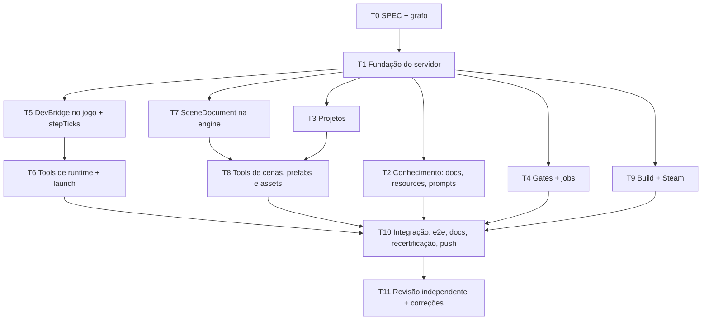

# MCP da engine — grafo de tarefas

Plano de execução da [`SPEC.md`](./SPEC.md). Cada tarefa tem dependências,
arquivos que pode tocar (**dono exclusivo** — duas tarefas paralelas nunca
editam o mesmo arquivo), entregas e critério de pronto. Status atualizado ao
fim de cada onda.

## Grafo

Ondas: **0** = T0 · **1** = T1 · **2** = T2, T3, T4, T5, T7, T9 (paralelo) ·
**3** = T6, T8 (paralelo) · **4** = T10 · **5** = T11.

## Tarefas

### T0 — SPEC e grafo · dono: integrador · status: FEITO
Arquivos: `docs/mcp/SPEC.md`, `docs/mcp/TASK_GRAPH.md`.

### T1 — Fundação do servidor · depende de T0
Arquivos: `package.json` (deps + scripts `mcp`, `mcp:typecheck`), `tools/mcp/**`
(`src/server.ts`, `src/core/*`, `src/tools/index.ts` com um módulo vazio por
domínio: `knowledge.ts`, `projects.ts`, `gates.ts`, `jobs.ts`, `runtime.ts`,
`scenes.ts`, `assets.ts`, `build.ts`), `tools/mcp/tsconfig.json`, `.mcp.json`,
`tests/mcp/harness.ts`, `tests/mcp/core.test.ts`, `vite.config.ts` (excluir
`.claude/**` e `tools/mcp/**/fixtures` do vitest).
Entregas: `defineTool`/`registerDomain`, envelope de erro, `paths`, `exec`
(allowlist), `JobManager` (+ tools `job_*`), `config`, harness
`createTestClient()` (InMemoryTransport). Cada domínio exporta
`export const tools: ToolDef[] = []` para T2–T9 preencherem sem conflito.
Pronto quando: `npm run mcp` responde `tools/list`; testes de paths
(escape, link simbólico, escrita proibida), exec (fora da allowlist), jobs
(start/log/cancel/limite) passam; `npm run mcp:typecheck` limpo.

### T2 — Conhecimento · depende de T1
Arquivos: `tools/mcp/src/tools/knowledge.ts`, `tools/mcp/src/resources.ts`,
`tools/mcp/src/prompts.ts`, `tests/mcp/knowledge.test.ts`.
Entregas: `engine_info`, `docs_index`, `docs_read`, `docs_search`, `module_api`,
`gaps_list`, `recipes_list`, `recipe_read`; resources `engine://…`; 4 prompts.
`module_api` lê `docs/ai/modules/<key>.md` + `src/tokens/<key>.ts` (assinaturas
por regex/TS AST via `typescript`, já instalado).
Pronto quando: cada tool testada com dados reais do repo; `gaps_list` bate com
as linhas abertas do GAPS.md.

### T3 — Projetos · depende de T1
Arquivos: `tools/mcp/src/tools/projects.ts`, `tools/mcp/templates/project/**`,
`tests/mcp/projects.test.ts`.
Entregas: `project_list`, `project_create` (templates minimal/physics gerados a
partir de `src/projects/_template`), `project_files`, `project_read_file`,
`project_write_file`, `project_report_append`, `project_check`, `project_delete`.
Testes usam um repositório temporário (cópia mínima) via `ENGINE_MCP_ROOT`.
Pronto quando: jogo criado passa `tsc` e `project:isolation`; escrita fora do
jogo é recusada.

### T4 — Gates · depende de T1
Arquivos: `tools/mcp/src/tools/gates.ts`, `tools/mcp/src/core/parsers.ts`,
`tests/mcp/gates.test.ts`.
Entregas: `gate_run` (todos os gates da SPEC 3.3, síncrono ou job), `test_run`
(vitest `--reporter=json`), `audit_run` (stages 71–90), parsers de saída de
tsc/vitest/arch/auditorias para `failures[]`.
Pronto quando: parsers testados com saídas reais gravadas como fixtures;
`gate_run tsc` real passa no repo.

### T5 — DevBridge no jogo · depende de T1
Arquivos: `src/debug/devbridge/**`, `src/app/bootstrap.ts` (só o gancho de
`import()` dinâmico), `tools/mcp/src/runtime/protocol.ts` (re-exporta
`src/debug/devbridge/protocol.ts`), `src/tokens/game-loop.ts` +
`src/engine/game-loop/**` (`stepTicks(n)`), `tests/devbridge.test.ts`.
Entregas: cliente WS com handshake/token, tabela fechada de métodos (SPEC 3.4),
captura de console/erros/eventos em anel, screenshot (`canvas.toDataURL` com
`preserveDrawingBuffer` ou captura no próximo frame), input sintético, carga de
cena ao vivo (usa T7 quando existir; até lá responde `NOT_AVAILABLE`).
Pronto quando: teste jsdom com servidor ws falso cobre handshake, token errado,
método desconhecido, cada método; `dist/` de produção não contém DevBridge.

### T6 — Tools de runtime · depende de T5
Arquivos: `tools/mcp/src/tools/runtime.ts`, `tools/mcp/src/runtime/**`
(servidor ws, sessões, launcher vite + Playwright), `tests/mcp/runtime.test.ts`.
Entregas: todas as tools da SPEC 3.4; `runtime_launch` com porta livre, timeout
de boot 60 s, limpeza de processos em `runtime_stop` e no encerramento do MCP.
Pronto quando: testes com DevBridge real em jsdom contra o servidor real; e2e
headless opcional (`ENGINE_MCP_E2E=1`) roda no ambiente com Chromium.

### T7 — SceneDocument na engine · depende de T1
Arquivos: `src/contracts/world/scene-document.ts`, `src/contracts/world/types.ts`
(re-export), `src/tokens/world.ts` (`loadSceneDocument`),
`src/engine/world/internal/SceneDocumentLoader.ts`,
`src/engine/world/internal/WorldService.ts` (fiação),
`src/projects/_template/recipes/16-scene-document.ts`,
`docs/ai/notes/world.md`, `tests/scene-document.test.ts`.
Entregas: tipos + validadores puros, loader com prefabs/assets, evento de erro.
Pronto quando: fixtures válidas/inválidas testadas; cena carregada gera os
mesmos snapshots que spawns manuais.

### T8 — Tools de cenas/prefabs/assets · depende de T7 e T3
Arquivos: `tools/mcp/src/tools/scenes.ts`, `tools/mcp/src/tools/assets.ts`,
`tools/mcp/src/core/gltf.ts`, `tools/mcp/src/core/images.ts`,
`tests/mcp/scenes.test.ts`, `tests/mcp/assets.test.ts`, fixtures.
Entregas: todas as tools da SPEC 3.5 (validação reutiliza
`validateSceneDocument`); leitura de GLB/PNG/JPG/WebP sem dependência nova.
Pronto quando: cena criada pelo MCP carrega via `loadSceneDocument` no teste.

### T9 — Build e Steam · depende de T1
Arquivos: `tools/mcp/src/tools/build.ts`, `tools/mcp/src/core/vdf.ts`,
`tests/mcp/build.test.ts`.
Entregas: tools da SPEC 3.6; VDF gerado conforme SteamPipe (`appbuild` /
`depotbuild`, `ContentRoot`, `FileMapping`); `build_web` real testado;
`build_desktop` testado com `exec` simulado.
Pronto quando: VDFs batem com fixtures; `desktop_config_set` recusa
identifier do host e chaves desconhecidas.

### T10 — Integração · depende de T2, T4, T6, T8, T9
Integrador: merge das ondas, e2e completo (SPEC 5.3), `docs/mcp/README.md`,
menção em `docs/ai/RULES.md`, regenerar manual, recertificar baselines Layer-1
(world/game-loop/public API mudaram), gates completos, push.

### T11 — Revisão independente · depende de T10
Agente revisor sem contexto: segurança (paths, exec, bridge), aderência à SPEC,
testes que não testam nada, docs. Correções e push final.

## Regras para quem executa
- Uma tarefa = um agente = uma worktree; commits pequenos por entrega.
- Só tocar os arquivos da sua tarefa. Precisa de algo de outra? Registre no
  relatório final; o integrador resolve.
- Nada de baselines (`LAYER1_*.json`), `.freeze-lock.json` ou
  `scripts/architecture/*` — o integrador recertifica.
- Mensagens e docs em pt-BR.
